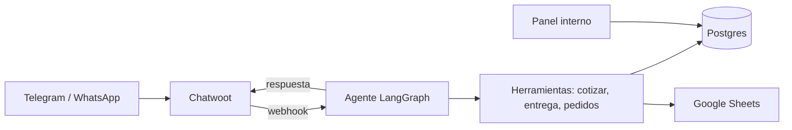

# Mundo Gráfico, agente de ventas con IA

Agente de ventas por WhatsApp y Telegram para una gráfica e imprenta: cotiza, consulta el catálogo, toma pedidos y agenda la entrega, con panel interno y Chatwoot.

> Este proyecto está basado en [basdonax-ai-agentkit](https://github.com/fcori47/basdonax-ai-agentkit) de Facundo Corengia, el kit usado en el curso de Fundación Forge. El kit original (licencia MIT, sin cambios en `LICENSE`) aporta la base del agente con LangGraph, los canales y la memoria. Su README original está en [docs/README-basdonax.md](docs/README-basdonax.md). El historial conserva los commits de los autores originales. La capa del negocio, los tests y las integraciones descritas abajo son trabajo de Elias Novoa (16 de los 20 commits).

## Qué problema resuelve

Una imprenta de barrio resuelve a mano y de memoria cuánto cuesta un trabajo, si llega para la fecha pedida y en qué estado está cada pedido. Este agente atiende las consultas de clientes por mensajería, cotiza con el catálogo real y reserva la fecha según la carga del taller, y deriva a una persona cuando hace falta.

## Mi parte (lo que se agregó sobre el kit)

Regla de diseño central: el modelo no calcula nada. Cotizar y calcular la entrega son herramientas que leen la base y devuelven números ya calculados.

- `src/mundografico/`: catálogo y cotización (`catalogo.py`), agenda de entrega por día con candado transaccional (`agenda.py`, `pedidos.py`), horario de Argentina, registro de ventas en Google Sheets (`sheets.py`).
- Herramientas del agente: buscar producto, cotizar, calcular entrega, crear pedido, consultar estado de pedido y pasar a una persona.
- Integración con Chatwoot: cliente propio de la API (contactos, etiquetas, notas privadas), webhook y aviso de "pedido listo".
- Panel interno con FastAPI, Jinja2 y HTMX: pedidos, catálogo y taller.
- Migraciones SQL (esquema, catálogo semilla y datos de demostración ficticios) sobre Postgres.
- Prompts del sistema, `servidor_mundografico.py` como entrypoint y Dockerfile.
- 16 archivos de tests con pytest. Más detalle en [MUNDOGRAFICO.md](MUNDOGRAFICO.md).

## Funcionalidades

- Conversación por Telegram (y WhatsApp vía Chatwoot) con memoria por conversación.
- Cotización con escalas de cantidad por producto.
- Reserva de fecha según minutos de taller disponibles por día.
- Pedidos con estados, aviso de retiro y pausa humana.
- Panel web protegido con clave.

## Stack

| Capa | Tecnología |
|---|---|
| Lenguaje | Python |
| Agente | LangGraph y LangChain (Claude por defecto) |
| Canales | Chatwoot, Telegram |
| Base de datos | Postgres (schema `mundografico`) |
| Panel | FastAPI, Jinja2, HTMX |
| Integraciones | Google Sheets (gspread) |
| Despliegue | Docker, Coolify |
| Tests | pytest |

## Arquitectura



## Cómo correrlo localmente

```bash
python -m venv .venv
.venv\Scripts\activate          # Windows
pip install -r requirements-mundografico.txt
copy .env.example .env          # completá tus propias claves
python servidor_mundografico.py
```

Se necesitan Postgres y Chatwoot accesibles. Las variables están en `.env.example`. Los pedidos de demostración solo se cargan con `MG_MODO_DEMO=true`.

## Tests

```bash
pip install -r requirements-dev.txt
pytest
```

Cubren cotización, agenda, herramientas, panel, cliente de Chatwoot, canales, prompts, servidor y Sheets. Los tests de integración con Postgres requieren una base disponible.

## Estado del proyecto

Demo desplegada en un VPS con Coolify, HTTPS y Postgres, probada de punta a punta en una bandeja interna de Chatwoot (cotización, agenda, pedido, aviso de retiro, entrega y pausa humana). Los precios del catálogo y la política de pago son de ejemplo, y el repositorio no incluye datos reales del cliente. Ver [AUDITORIA-PLAN.md](AUDITORIA-PLAN.md) para el estado preciso y los pendientes.

## Qué aprendí

- Mantener la lógica de precios y fechas fuera del modelo, en herramientas determinísticas con tests.
- Extender un kit existente sin reescribirlo, manteniendo la capa propia separada del código original.
- Integrar un agente con Chatwoot, Postgres y Google Sheets y desplegarlo con Docker.
- Escribir tests con pytest para agente, panel y capa de datos.

## English summary

Mundo Gráfico is an AI sales agent for a print shop. Customers talk to it on WhatsApp or Telegram through Chatwoot, and it gives quotes, checks the catalog, creates orders and books a delivery date. The model never does the math: tools read the database and return the numbers. This project is built on top of the course starter basdonax-ai-agentkit by Facundo Corengia (MIT license), and the original commits are kept in the history. My own part is the business layer in `src/mundografico/`, the internal panel, the Chatwoot and Google Sheets integrations and the pytest tests. It is a demo deployed on a VPS, and the catalog prices are examples.